

  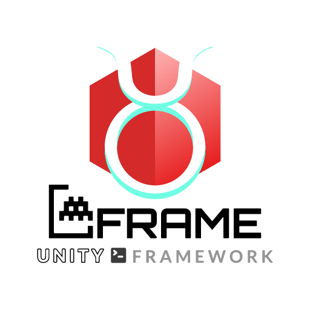

---

## 官方主頁 (OxGFrame with [YooAsset](https://github.com/tuyoogame/YooAsset) + [HybridCLR](https://github.com/focus-creative-games/hybridclr))

- [官方文檔](https://oxgframe.ouhiyo.com/)
- [快速上手 (安裝教程)](https://oxgframe.ouhiyo.com/docs/getting-started)

※細節說明與完整教學皆以官方文檔為準，此頁僅作總覽。

---

## 基本介紹

OxGFrame 是基於 Unity 用於加快遊戲開發的框架，並且使用 UniTask 進行異步處理，從資源加載 (AssetLoader)、遊戲介面 (UIFrame)、場景資源 (SRFrame)、Unity 場景 (USFrame)、模板物件 (CPFrame)、音樂音效 (AudioFrame)、影片 (VideoFrame)、遊戲階段整合 (GSIFrame)、網路 (NetFrame)、事件中心 (CenterFrame)，能夠簡單入手與有效的加快開發效率，並且支持多平台 Win、OSX、Android、iOS、WebGL (皆通過測試)。

https://github.com/michael811125/OxGFrame/assets/30960759/fd04f6e5-6338-400c-9f57-dcdbdf73dfff

相關模板建立的選單 (Create menu items)

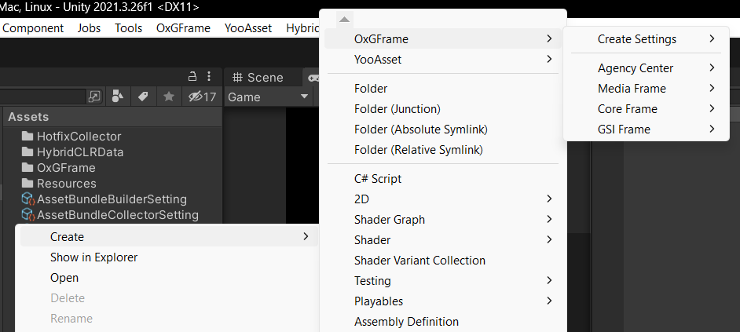

---

## 環境需求

### Unity 版本

- 最低支援 Unity 2021.3 (LTS)
- 建議使用 Unity 2022.3 (LTS) or higher - [Unity Download](https://unity3d.com/get-unity/download/archive)
- 已驗證版本：Unity 2022.3、Unity 6.3 (6000.3)

### YooAsset 版本

- 同時相容 YooAsset 2.x (以 2.3.18 驗證) 與 YooAsset 3.0.5+，依安裝版本自動定義 `YOOASSET_2` / `YOOASSET_3` 切換代碼 (Assembly Version Defines)。
- ※注意 : YooAsset 3.0.0 ~ 3.0.4 不支援；v2 與 v3 建置的 Bundle 互不相容，切換版本後需重新建置資源。

### 依賴的工具庫

- [OxGKit](https://github.com/michael811125/OxGKit)

---

## 模塊框架介紹

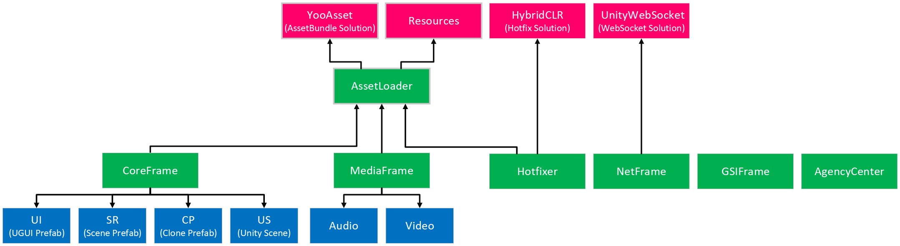

### Hotfixer (dependence HybridCLR, AssetLoader)

代碼熱修復模塊，集成 [HybridCLR](https://github.com/focus-creative-games/hybridclr) 革命性熱更新方案 (相關建置請參考 [HybridCLR 官方文檔](https://hybridclr.doc.code-philosophy.com/))。建置完成後，可透過選單 HybridCLR/OxGFrame With HybridCLR/Compile And Copy To HotfixCollector 一鍵編譯拷貝熱更 DLL，再由 YooAsset Collector 收集打包 (使用流程詳見 HotfixerDemo)。

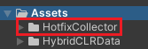
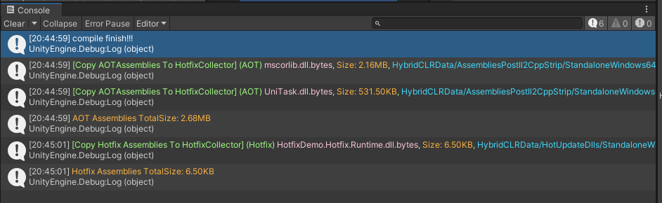
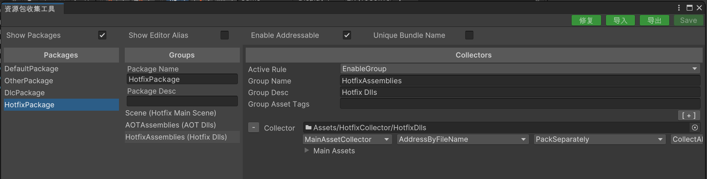

※備註 : 運行打包 HotfixerDemo 需要 Import PatchLauncher from PackageManager

### AssetLoader (dependence YooAsset)

資源加載器模塊，支援動態 Async 或 Sync 加載與計數管理 (Resources 與 AssetBundle 成對 Load & Unload)。AssetBundle 集成 YooAsset 實現資源熱更新方案，支援 App 與 DLC 分包管理 (PackageOperation)、群組分包下載、磁碟空間檢查、下載途中直接修復，並實現 YooAsset 加解密介面：Offset、XOR、HT2XOR、HT2XOR-Plus、AES、ChaCha20、XXTEA、OffsetXOR ([加解密效率比較](https://github.com/michael811125/OxGFrame/wiki/Encryption-and-Decryption-Efficiency-Reference))。

- ※備註 : Use "res#" will load from Resources else load from Bundle
- ※提醒 : 使用 Bundle 開發時，需先將 PatchLauncher 拖曳至場景中 (透過 Samples Import PatchLauncher Prefab)

#### 群組分包舉例

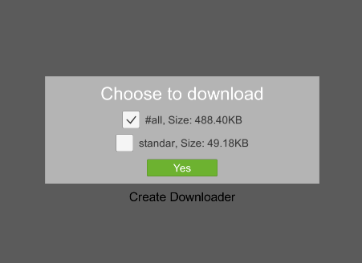

#### 資源更新過程 (支援下載途中直接進行修復功能)

https://github.com/michael811125/OxGFrame/assets/30960759/11dcf0d3-41bd-4a8d-af6b-7115374552f5

#### Disk Space 檢查流程

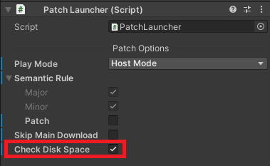

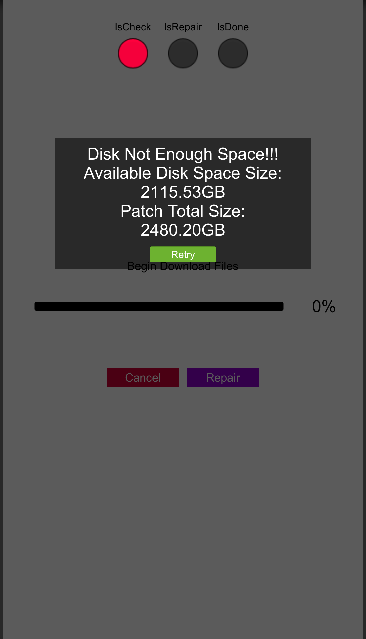

#### 使用 PackageOperation 進行 DLC 資源包的操作

https://github.com/michael811125/OxGFrame/assets/30960759/694d1125-cf9f-42bb-85f4-df42041057c7

### CoreFrame (dependence AssetLoader)

核心模塊 (連動 AssetLoader 實現自動卸載)，實現物件命名綁定與代碼自動生成 (綁定 Hotkey: Shift+B、停止標籤 Hotkey: Shift+E)。

- UIFrame : UI Prefab 調度 (UGUI)，支援 UI 反切 (Reverse Changes)、堆疊關閉 (Close Stack By Stack)、隱藏凍結與遮罩事件 (綁定使用 _Node@XXX)。
- SRFrame : 場景資源 Prefab 調度 (綁定使用 _Node@XXX)。
- USFrame : Unity 場景調度 (支援 AssetBundle)。※備註 : Use "build#" will load scene from Build else load scene from Bundle
- CPFrame : 模板物件實例調度，直接 GameObject.Destroy 即自動卸載 (綁定使用 ~Node@XXX)。

| UI 反切運用 (Reverse Changes)  | UI 反切運用 (Reverse Changes) |
|:-|:-|
| 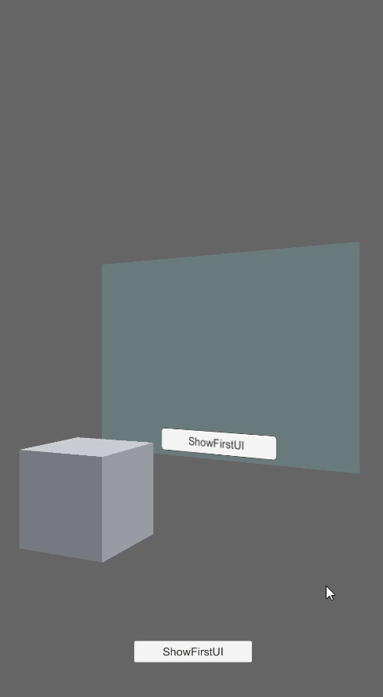 |  |

| UI 堆疊關閉運用 (Close Stack By Stack)  | UI 堆疊關閉運用 (Close Stack By Stack) |
|:-|:-|
| 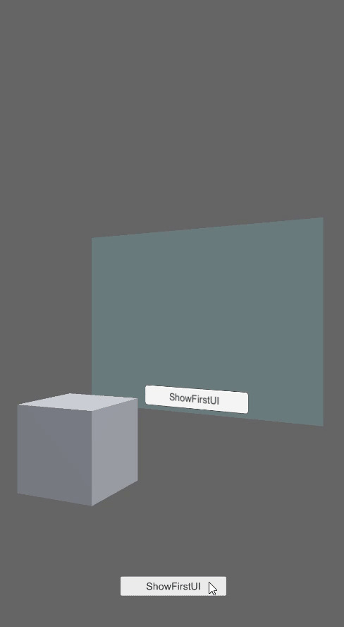 |  |

#### 物件綁定與代碼自動生成

綁定說明

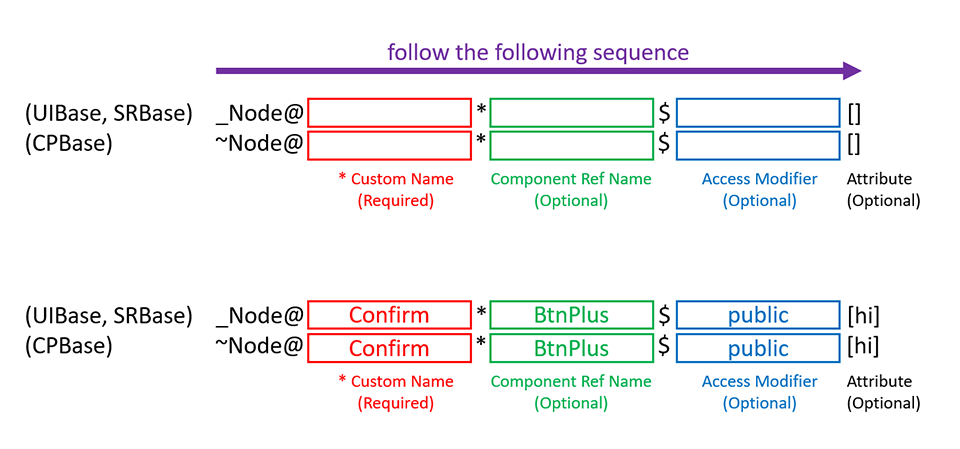

綁定配置

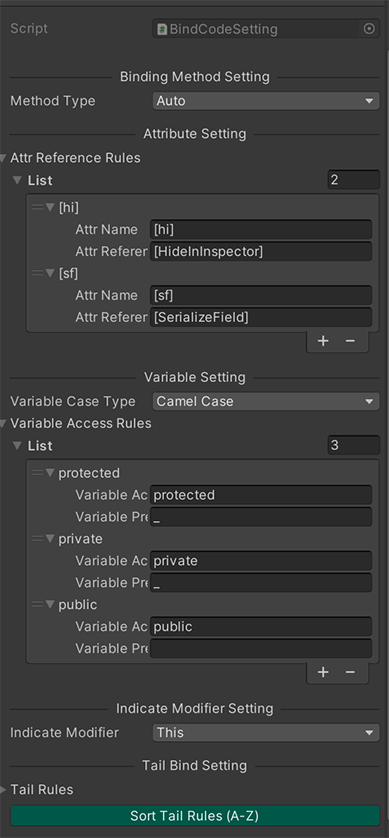

自動生成停止綁定標籤 (Hotkey: Shift+E)

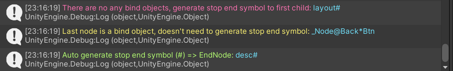

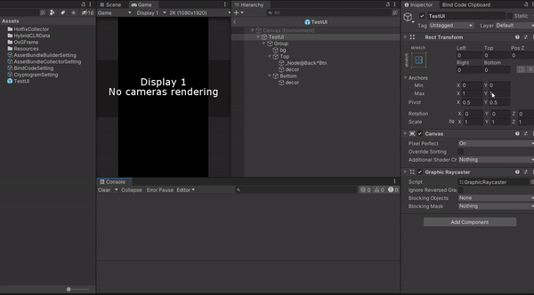

自動生成物件綁定代碼 (Hotkey: Shift+B) - 自動 (Auto)

https://github.com/michael811125/OxGFrame/assets/30960759/4c61bede-0bbc-4cae-baba-4a9bc7274c2e

自動生成物件綁定代碼 (Hotkey: Shift+B) - 手動 (Manual)

https://github.com/michael811125/OxGFrame/assets/30960759/8e4f63e9-b955-4f91-8ac7-be949677c54f

### MediaFrame (dependence AssetLoader)

影音模塊 (連動 AssetLoader 實現自動卸載)，支援多平台加載方式 (Local, StreamingAssets, URL)，並針對 WebGL 進行細節校正。

- AudioFrame : Audio (2D/3D) 播放，採用 Unity Mixer 進行音軌控制 (需透過 Samples Import AudioManager Prefab)。
- VideoFrame : Video 播放，支援 RenderTexture 與 Camera 渲染模式。

### GSIFrame

遊戲階段整合模塊 (FSM 概念)，將 Startup、Logo、Hotfix、Patch、Login、Lobby、Fight 等遊戲階段統一整合與切換 (階段規劃依專案自行劃分實作)。

### NetFrame (dependence OxGKit.Utilities)

網路模塊，以 NetManager 管理多網路節點 (NetNode)，支援心跳檢測、超時處理、重新連接回調與 INetTips 網路狀態介面，可自行擴展 Provider，目前提供：

- TCP ([Telepathy](https://github.com/MirrorNetworking/Telepathy))，已處理分黏包 (Packet 前 4 bytes 表示封包長度)
- KCP ([kcp2k](https://github.com/MirrorNetworking/kcp2k))
- WebSocket ([UnityWebSocket](https://github.com/psygames/UnityWebSocket))

示例使用 [ioGame](https://github.com/iohao/ioGame) 作為服務端：

| ioGame Server (TCP) | NetFrame - TcpNetProvider Client |
|:-:|:-:|
| 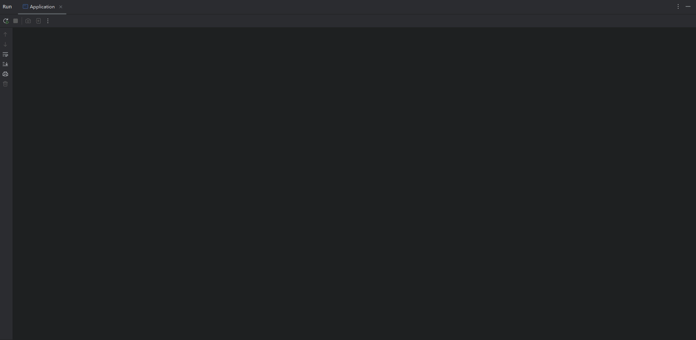 | 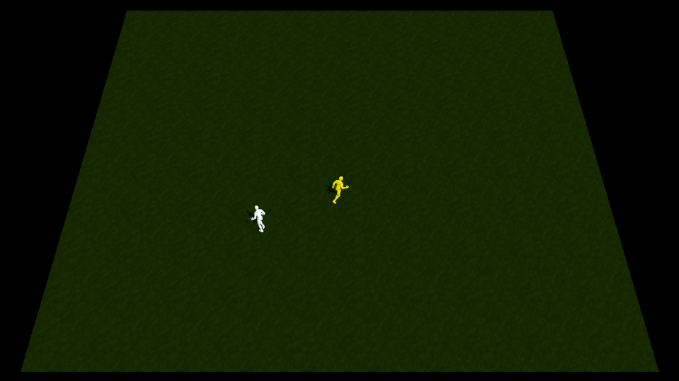 |
| 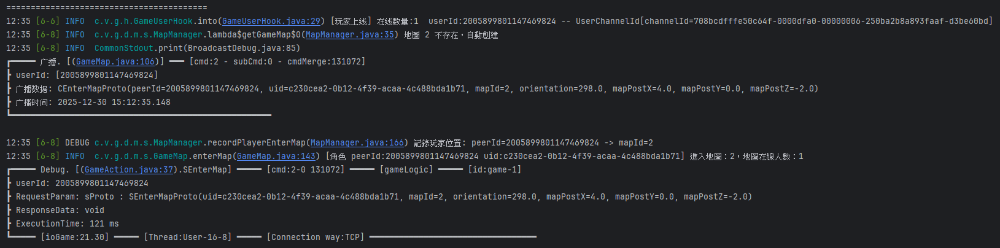 | 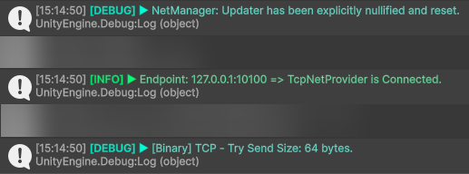 |

| ioGame Server (WebSocket) | NetFrame - WebSocketNetProvider Client |
|:-:|:-:|
| 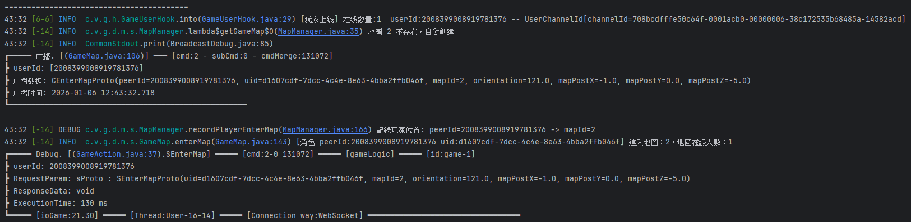 | 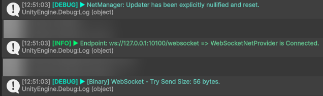 |

### CenterFrame

事件委派中心，自定義管理類繼承 CenterBase<TCenter, TClass> 實現簡易事件派送，預設提供：

- EventCenter : 集中式 Event 整合模塊，自定義每個 Event 格式進行派送。
- APICenter : 集中式 Http API 整合模塊，使用 Acax 請求 (Http.Acax、HttpNativeClient.Acax、HttpNativeWebRequest.Acax)。

---

## 使用 OxGFrame 實現的 Demo 小遊戲

[Github - FlappyBird_OxGFrame](https://github.com/michael811125/FlappyBird_OxGFrame)
  - [Resources](https://github.com/michael811125/FlappyBird_OxGFrame/tree/resources)
  - [AssetBundle](https://github.com/michael811125/FlappyBird_OxGFrame/tree/assetbundle)
  - [AssetBundle + HybridCLR](https://github.com/michael811125/FlappyBird_OxGFrame/tree/assetbundle_clr)

https://github.com/michael811125/OxGFrame/assets/30960759/5e41e84a-029d-4392-8142-7199ce45018c

---

## Wiki

- [Coding Style wiki (代碼風格)](https://github.com/michael811125/OxGFrame/wiki/Coding-Style)
- [Macro Defitions wiki (宏定義)](https://github.com/michael811125/OxGFrame/wiki/Macro-Definitions)
- [Encryption and Decryption Efficiency wiki (加解密效率)](https://github.com/michael811125/OxGFrame/wiki/Encryption-and-Decryption-Efficiency-Reference)
- [Roadmap wiki](https://github.com/michael811125/OxGFrame/wiki/Roadmap)

---

## 特別感謝

[killop - anything_about_game](https://github.com/killop/anything_about_game#unity-framework)

[UWA 開源庫](https://lab.uwa4d.com/lab/62d51e6fa8103dabd0cce57f)

[YooAsset 友情鏈結](https://www.yooasset.com/docs/community/Blogroll)

[OxGFrame 开源项目使用教程](https://blog.csdn.net/gitblog_00798/article/details/142840300)

[开启游戏开发新纪元 —— OxGFrame 框架深度解析](https://blog.csdn.net/gitblog_00035/article/details/139977201)

---

## 討論區

---

## Donate

---

## License

This library is under the MIT License.
